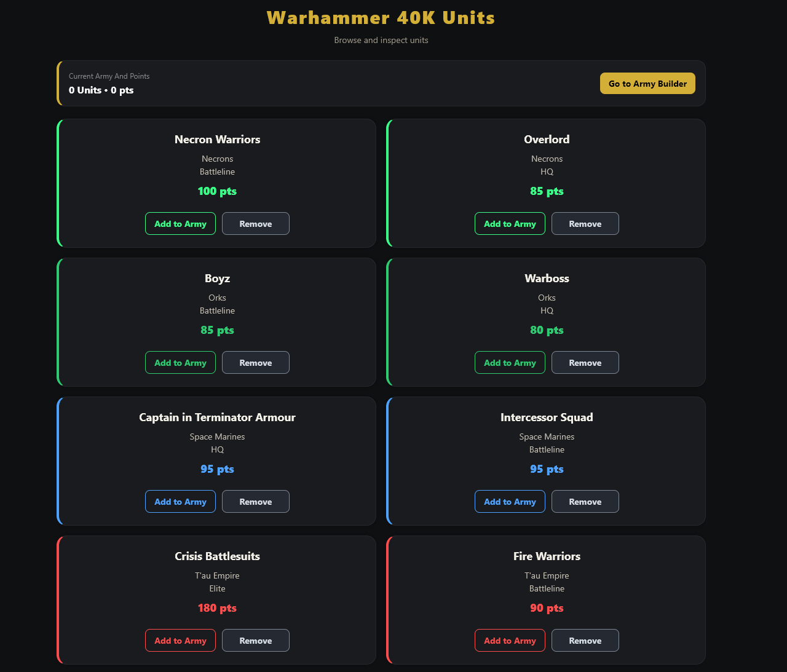

# Warhammer 40K Army Builder

A full-stack mobile app for browsing Warhammer 40,000 units and putting together an army list with a running points total.

- **App:** React Native (Expo), runs on Android, iOS and web
- **API:** Node.js + Express REST API
- **Database:** MongoDB Atlas via Mongoose

<!-- Add screenshots here, e.g.  -->

## Features

- Lists units from the API, with a colour theme for each faction
- Unit detail screen with image, faction, role and points cost
- Army builder: add or remove units and see the total points update live
- Identical units are grouped in the army list (e.g. "Boyz x3")
- Responsive layout with two columns on wide screens
- Loading and error states, including a retry button

## Project structure

```
warhammer-reactnative/   Expo app
  src/screens/           Home, UnitDetails and Army screens
  src/context/           ArmyContext: global army state (React Context)
  src/components/        Shared UI components
  src/theme/             Faction colours
  src/config.js          API URL configuration
warhammer_api/           Express API
  models/                Mongoose schema for units
  server.js              Routes and database connection
```

## API

| Method | Route        | Description                                  |
| ------ | ------------ | -------------------------------------------- |
| GET    | `/`          | Health check                                 |
| GET    | `/api/units` | All units, sorted by faction and then name   |

## Getting started

Requirements: Node.js 18 or later, and a MongoDB Atlas cluster (the free tier is enough).

### 1. API

```bash
cd warhammer_api
cp .env.example .env    # then fill in MONGO_URI
npm install
npm start
```

### 2. App

```bash
cd warhammer-reactnative
cp .env.example .env    # point EXPO_PUBLIC_API_URL at the API
npm install
npx expo start
```

Press `w` to open the app in the browser, or scan the QR code with Expo Go. On a phone, `EXPO_PUBLIC_API_URL` must be your computer's local IP address rather than `localhost`.

---

*This is a fan project made for learning purposes and is not affiliated with Games Workshop. Warhammer 40,000 and all related names and images belong to Games Workshop Ltd.*
